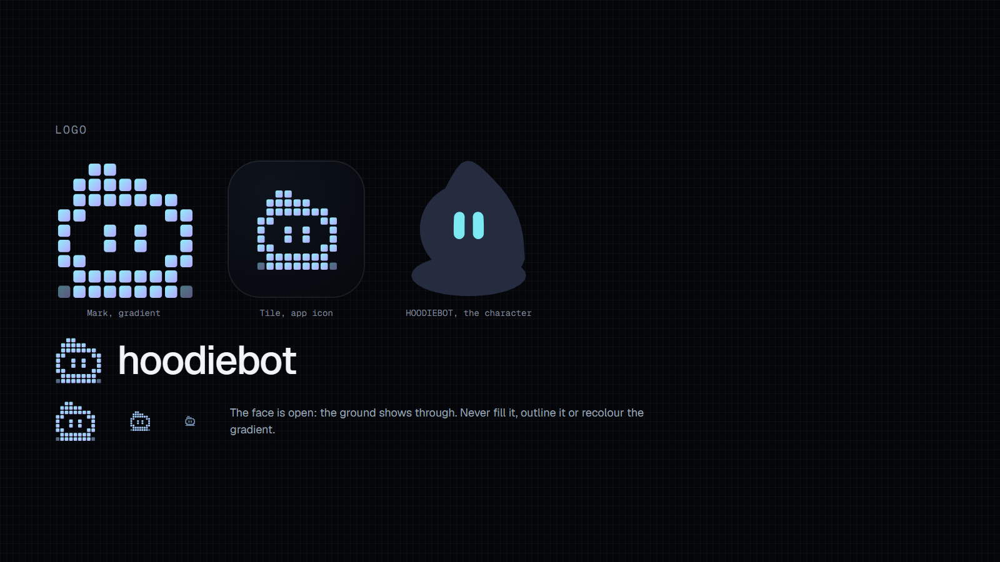
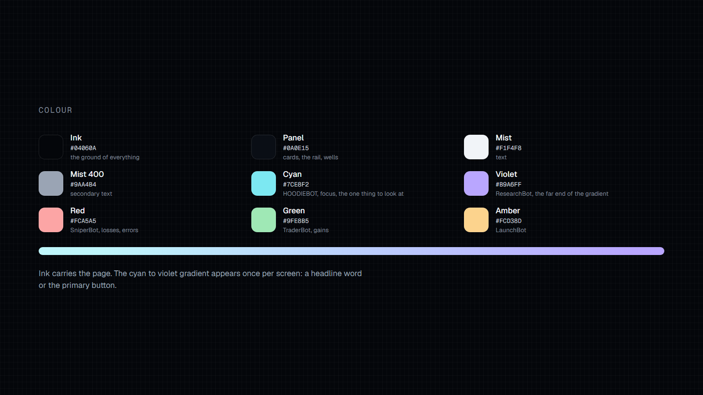
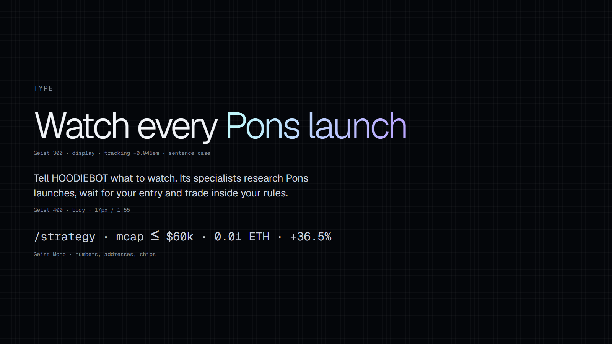

# HOODIEBOT brand kit

Built on the Kurage design language (dark ink, mist text, one cyan-to-violet gradient, Geist and Geist Mono, ASCII
light fields). Every image here is rendered from a live page in the app (`components/kit/Kit.tsx`, served at
`/kit/<name>` in development only) so it uses the same tokens, avatar and field as the product.

```
npm run dev
npm run brand              # all images
npm run brand -- og        # one
```





## Logo

| File | Use |
|---|---|
| `logo/hoodiebot-mark.svg` | **Primary.** The hood on Kurage's pixel grid, cyan to violet. Dark grounds. |
| `logo/hoodiebot-mark-mono.svg` | One colour (`currentColor`). |
| `logo/hoodiebot-mark-ink.svg` | Ink, for light grounds, stamps and merch. |
| `logo/hoodiebot-tile.png` | The mark on a rounded ink square, 1024×1024. App icon (`app/apple-icon.png`). |
| `x-profile.png` | X avatar, 800×800, circle-safe: HOODIEBOT itself. |
| `x-banner.png` | X header, 3000×1000 (1500×500 @2x). Text sits clear of the avatar overlap at bottom left. |

Rules:
- The face of the mark is open: the ground shows through it. Never fill it, outline it or recolour the gradient.
- The wordmark is `hoodiebot` set in Geist 500, tracking −0.025em, beside the mark. In copy the name is HOODIEBOT.
- One logo per image.

## The character

HOODIEBOT is a hooded bot whose hood flops to one side, drawn with the procedural avatar engine
(`@bible-strong/avatar-react`, definition in `lib/avatar/hoodiebot.avatar.json`). The four specialists are the same bot
with different eyes:

| Bot | Eyes |
|---|---|
| HOODIEBOT | `#7CE8F2` cyan |
| ResearchBot | `#B9A6FF` violet |
| SniperBot | `#FCA5A5` red |
| TraderBot | `#9FE8B5` green |
| LaunchBot | `#FCD38D` amber |

## Colour and type

See the sheets above. Ink carries the page; the gradient marks one thing per screen. Green is only for gains, red for
losses and errors. Headlines in Geist 300, body in Geist 400, numbers, addresses and chips in Geist Mono.

Not used, on purpose: small all-caps eyebrows above headlines, glowing status dots, accent-coloured links.

## Link previews

`public/og/home.png`, `litepaper.png`, `app.png` (1200×630) are wired into each page's metadata.

## Posts

`posts/*.png` (1600×900) with their captions in `posts/*.txt`.

## Launch film

`video/hoodie-launch.mp4` (1920×1080, 30 fps, about 31 s) with its caption in `posts/launch.txt`. The scenes live in
`components/promo/` and play at `/promo` on the dev server; `node brand/promo.mjs` records them through Chrome's
screencast and encodes with ffmpeg.
